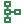

**English** | [简体中文](./README.zh-CN.md)

<div align="center">


# LastWord

**The transcript overlay that pins a coding agent's final answer for developers.**

Multi-hour Claude Code sessions bury the operative answer in hundreds of turns of narration. LastWord reads the finished transcript and pins the verdict — the final decision, what changed, and machine-checkable pointers to the exact turns that produced it — so a 500-turn run ends with one visible answer instead of another scroll.

[](https://github.com/SuperMarioYL/lastword/actions/workflows/ci.yml)
[](https://github.com/SuperMarioYL/lastword/releases)
[](https://go.dev/)
[](./LICENSE)


<picture>
  <source media="(max-width: 640px) and (prefers-color-scheme: dark)" srcset="assets/presentation/hero-mobile-dark.svg">
  <source media="(max-width: 640px)" srcset="assets/presentation/hero-mobile-light.svg">
  <source media="(prefers-color-scheme: dark)" srcset="assets/presentation/hero-dark.svg">
  
</picture>

</div>

---

##  Quickstart

Requires Go 1.24+. Everything runs locally — no API keys, no model calls, no network.

```bash
git clone https://github.com/SuperMarioYL/lastword.git
cd lastword
go build -o /tmp/lastword ./cmd/lastword
```

Try it on the bundled 500-turn session (a sanitized synthetic fixture shaped like a real Claude Code transcript):

```bash
/tmp/lastword verdict testdata/sessions/session-500turn.jsonl --format text
```

Then run it on your own machine, where Claude Code already wrote the session for you:

```bash
/tmp/lastword latest    # the newest main session under ~/.claude/projects
/tmp/lastword verdict   # its verdict span, discovered automatically
```

That is the whole v0.1 loop: one command in, one verdict out. The three lines above also live in [examples/quickstart.sh](examples/quickstart.sh).

##  Recorded demo

The commands and outputs below are copied verbatim from a real `0.1.0` run — full record in [docs/demo-results.json](docs/demo-results.json). The session under test is the bundled sanitized fixture (`testdata/sessions/session-500turn.jsonl`, 500 counted turns), staged as a demo projects tree; on your own machine the same commands read your newest session under `~/.claude/projects` through the identical code path.


The verdict panel, as printed by `lastword verdict --format text`:

```text
LastWord — verdict-span/v0
session 7f3d2c8a-1e94-4b67-9c02-5a8d3f6b1e47

ANSWER
  The login flake was a stale refresh-token cache key: rotating a session
  changed the in-memory key but never invalidated the old entry, so roughly
  one in five refreshes read a token the issuer had already rejected.

CHANGES (7)
  src/auth/token.go               +6   -6
  src/auth/session.go             +5   -3
  internal/api/middleware.go      +8   -5
  tests/refresh_rotation_test.go  +13  -0
  internal/api/server.go          +1   -1
  docs/auth.md                    +5   -0
  README.md                       +5   -0

RESULTS (6)
  [ok] go test ./...
  [ok] gofmt -w .
  [ok] go vet ./...
  [FAIL (exit 2)] npm --prefix web run build
  [ok] git log --oneline -3 -- web/
  [ok] go test ./... -run Auth

POINTERS (14)
  #500  final   answer.lead
  #8    edit    answer.changes[src/auth/token.go]
  #8    edit    answer.changes[src/auth/session.go]
  #11   edit    answer.changes[internal/api/middleware.go]
  #13   edit    answer.changes[tests/refresh_rotation_test.go]
  #37   edit    answer.changes[internal/api/server.go]
  #40   edit    answer.changes[docs/auth.md]
  #40   edit    answer.changes[README.md]
  #16   result  answer.results[go test ./...]
  #39   result  answer.results[gofmt -w .]
  #44   result  answer.results[go vet ./...]
  #45   result  answer.results[npm --prefix web run build]
  #47   result  answer.results[git log --oneline -3 -- web/]
  #48   result  answer.results[go test ./... -run Auth]

checks: not evaluated (verify arrives with milestone m2)
```

Note what the span gets right that the raw transcript hides: `go test ./...` failed early in the session and passed after the fix — the span claims the **last** outcome, the passing run at turn 16. The `npm` build failure is claimed as failed with its printed exit code. The same verdict as the open JSON document (head shown; the full document is in the record):

```json
{
  "schema": "verdict-span/v0",
  "session": "7f3d2c8a-1e94-4b67-9c02-5a8d3f6b1e47",
  "answer": {
    "lead": "The login flake was a stale refresh-token cache key: rotating a session changed the in-memory key but never invalidated the old entry, so roughly one in five refreshes read a token the issuer had already rejected.",
    "changes": [
      {
        "file": "src/auth/token.go",
        "added": 6,
        "removed": 6
      },
      {
        "file": "src/auth/session.go",
        "added": 5,
        "removed": 3
      },
      {
        "file": "internal/api/middleware.go",
        "added": 8,
        "removed": 5
      },
      {
        "file": "tests/refresh_rotation_test.go",
        "added": 13,
        "removed": 0
      }
      /* … 3 more files, 6 command results, 14 turn pointers,
         "checks": null — see docs/demo-results.json */
    ]
  }
}
```

##  Why LastWord exists

You come back to a terminal after a forty-five-minute Claude Code run. Somewhere in 500 turns of tool calls, retries and narration is the thing you actually need: what did it decide, what changed, do the tests pass. The last message is usually more narration, so you scroll — and scrollback search finds *mentions*, not *the verdict*.

The ecosystem's current fixes live one layer short of the problem:

- **Behavior skills** ([i-have-ADHD](https://github.com/ayghri/i-have-adhd), [caveman](https://github.com/JuliusBrussee/caveman)) *ask* the agent to lead with the answer or talk tersely. A prompt is a request, not a contract: any given run can still bury the answer, nothing checks a finished session, and a run that ended without the skill stays unreadable.
- **Transcript renderers** ([claude-code-log](https://github.com/daaain/claude-code-log)) make the scrolling nicer. But the answer is not distinguishable from narration at the format level, and their session summaries are generated re-descriptions — nothing resolves to specific turns, nothing is checkable.

LastWord replaces the request with a derived contract. Extraction is deterministic — it never calls a model — and two elements make the result a primitive rather than another summary:

- **The pointer**: every claim in the answer carries a resolvable, snippet-anchored reference to the specific turn that produced it. `answer.changes[src/auth/token.go]` is not a vibe, it is turn 8, with a verbatim quote.
- **The check semantics**: the spec defines what makes a span valid — every pointer must resolve to a real turn, and the claimed diff must equal the transcript's actual edit events. `lastword verify` (milestone m2) enforces exactly that, with a pass/fail exit code.

##  How it works

One Go binary, one process, no daemon, no server, no network calls.

```
~/.claude/projects/<project-dir>/<session-uuid>.jsonl
   (main sessions, one level deep; nested subagent transcripts excluded)
      |
      v
 transcript/claude.go    JSONL -> turns {uuid, role, text, toolUses, toolResults}
                        (sidechain entries and bookkeeping types skipped)
 transcript/discover.go  newest main-session lookup
      |
      v
 verdictspan/extract.go  deterministic rules -> VerdictSpan
        answer.lead = leading paragraph of the last assistant turn
        changes     = aggregated Edit/Write tool events
        results     = last outcome per command: ok mirrors is_error,
                      exit code parsed from "Exit code N" text when present
 verdictspan/schema.go  verdict-span/v0 types + open-format reference
      |
      v
 render/terminal.go     `lastword verdict`  stdout — canonical JSON, or a
                        readable panel with --format text
```

<picture>
  <source media="(max-width: 640px) and (prefers-color-scheme: dark)" srcset="assets/presentation/architecture-mobile-dark.svg">
  <source media="(max-width: 640px)" srcset="assets/presentation/architecture-mobile-light.svg">
  <source media="(prefers-color-scheme: dark)" srcset="assets/presentation/architecture-dark.svg">
  
</picture>

The extraction pipeline behind every span:

<picture>
  <source media="(max-width: 640px) and (prefers-color-scheme: dark)" srcset="assets/presentation/process-mobile-dark.svg">
  <source media="(max-width: 640px)" srcset="assets/presentation/process-mobile-light.svg">
  <source media="(prefers-color-scheme: dark)" srcset="assets/presentation/process-dark.svg">
  
</picture>

##  The verdict-span format

The span is a published open format — [docs/verdict-span-v0.md](docs/verdict-span-v0.md) — so other tools can emit and consume it. It is agent-generic by design; v0.1 of this CLI reads Claude Code session JSONL only.

```json
{
  "schema": "verdict-span/v0",
  "session": "<session uuid>",
  "answer": {
    "lead": "leading paragraph of the final assistant turn",
    "changes": [{"file": "src/auth.go", "added": 12, "removed": 4}],
    "results": [{"kind": "command", "cmd": "go test ./...", "ok": true, "exit_code": null}]
  },
  "pointers": [
    {"turn": 412, "uuid": "<message uuid>", "kind": "final | edit | result",
     "snippet": "verbatim 1-2 lines from that turn",
     "provenance": "which claim this turn backs"}
  ],
  "checks": [
    {"name": "pointer_resolution", "pass": true},
    {"name": "answer_diff", "pass": true, "detail": "3 files claimed, 3 edited, 0 unclaimed"}
  ]
}
```

Result entries are derived, not read: Claude Code tool_result blocks carry no structured exit code, so `cmd` comes from the paired tool_use (matched via `tool_use_id`), `ok` mirrors `is_error`, and `exit_code` is parsed from `Exit code N` free text only when a failure prints one. The spec also fixes the deterministic rules — what counts as a turn, how lines are counted, which outcome a repeated command claims — so independent implementations produce the same span.

##  Command line

| Command | What it does |
| --- | --- |
| `lastword verdict [file]` | Extract and print the verdict span; with no file, the newest main session is discovered |
| `lastword latest` | Print the path of the newest main-session transcript |

| Option | Default | Description |
| --- | --- | --- |
| `--format` | `json` | `json` — the canonical verdict-span/v0 document; `text` — a readable panel |
| `--projects-dir` | `~/.claude/projects` | Claude Code projects root, used by discovery |

Main sessions are the `*.jsonl` files directly inside a project directory; anything nested deeper (subagent transcripts) is excluded. When discovery runs, the resolved path is printed to stderr so stdout stays machine-readable.

##  Capabilities and integration

<picture>
  <source media="(max-width: 640px) and (prefers-color-scheme: dark)" srcset="assets/presentation/integrations-mobile-dark.svg">
  <source media="(max-width: 640px)" srcset="assets/presentation/integrations-mobile-light.svg">
  <source media="(prefers-color-scheme: dark)" srcset="assets/presentation/integrations-dark.svg">
  
</picture>

| Component | Current support |
| --- | --- |
| Input | Finished Claude Code session JSONL (the files under `~/.claude/projects`), read post-hoc |
| Change claims | `Edit` and `Write` tool events, aggregated per file with +/− line counts |
| Result claims | `Bash` use/result pairs matched by `tool_use_id`; last outcome per distinct command |
| Pointers | Turn number + message uuid + verbatim snippet for the lead, every file, every command |
| Output | `verdict-span/v0` JSON (default) and a terminal panel (`--format text`) |
| Fixtures | Sanitized synthetic sessions in `testdata/sessions/`, including a 500-turn run |

##  Configuration and limits

- **v0.1 reads finished Claude Code sessions only.** No Codex or Antigravity transcripts, no live-run hooks during a session, no cross-session search or indexing.
- **Checks are defined but not yet evaluated.** The spec's pointer-resolution and answer-diff semantics ship in `docs/verdict-span-v0.md`; `lastword verify` with a pass/fail exit code is milestone m2, so v0.1 emits `"checks": null`.
- **No viewer yet.** The pinned HTML panel with click-to-jump provenance is milestone m3; v0.1 prints JSON and a terminal panel.
- **Deterministic by design.** No LLM-generated summaries, no interpretation — a span claims only what the transcript objectively contains. A `Write` event counts added lines and claims nothing removed (the previous content is not in the transcript).
- **No config file, no telemetry, no model calls.** CLI flags only; everything runs locally.

##  Roadmap

- [x] **v0.1 (current, m1)** — turn parsing, newest-session discovery, deterministic verdict-span extraction (lead, changes, results, pointers), JSON + terminal output, open-format spec, 500-turn fixture
- [ ] **m2** — `lastword verify`: pointer-resolution and answer-diff machine checks with a pass/fail exit code, measured across ten real sessions
- [ ] **m3** — `lastword view`: a self-contained HTML viewer with the verdict pinned and click-to-jump provenance, plus the before/after demo recording

Not in v0.1 and not rushed: live-run enforcement, Codex/Antigravity transcript support, LLM-generated summaries, an MCP server exposing spans, IDE extensions, telemetry. The format and the CLI ship first; the substrate (open JSONL transcripts) already exists.

##  Development and license

```bash
go build ./... && go vet ./...
go test ./...
```

The suite covers JSONL parsing (block shapes, sidechain skipping, tool pairing), discovery, every extraction rule and the fixtures. Presentation artwork is regenerated with `python3 docs/render_presentation.py --repo .`.

[MIT](./LICENSE) © 2026 SuperMarioYL

---

<p align="center"><sub><a href="./LICENSE">MIT</a> © 2026 SuperMarioYL</sub></p>
